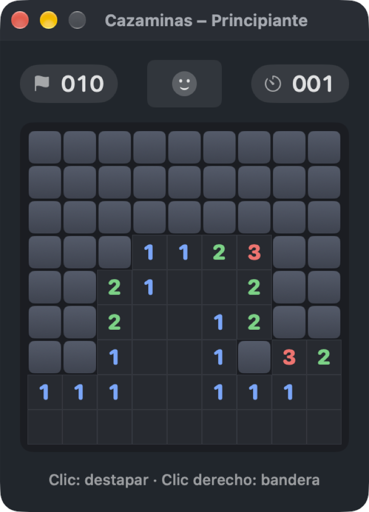
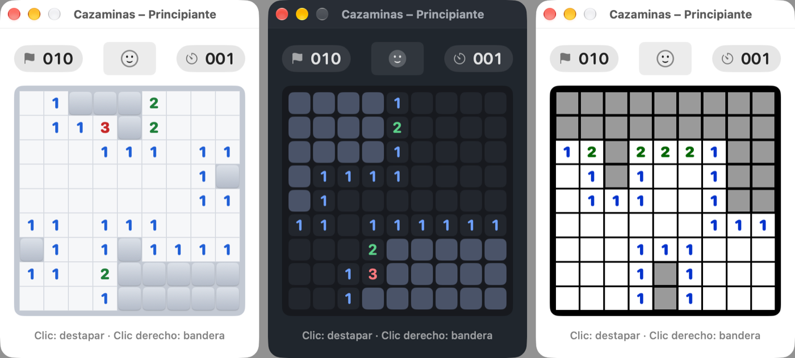
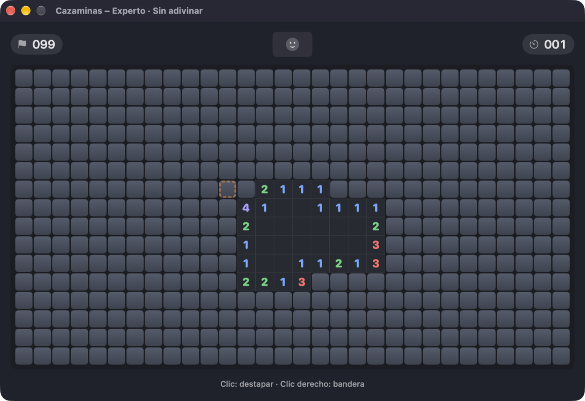
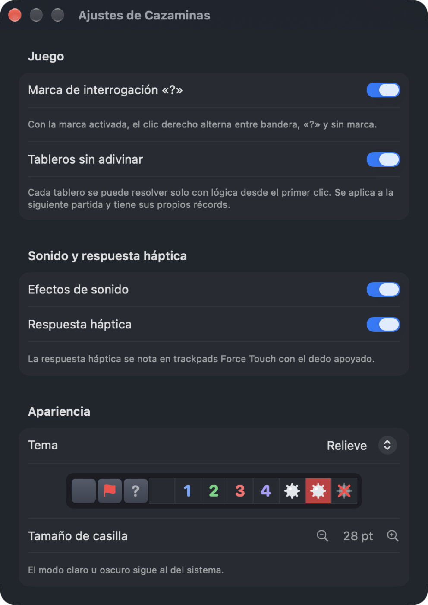

# Cazaminas

Juego de lógica para un jugador para macOS: despeja una cuadrícula de casillas ocultas sin detonar ninguna de las minas escondidas. Gratuito, de código abierto y escrito en Swift y SwiftUI.

<p align="center">
  
</p>

## Características

- Niveles **Principiante**, **Intermedio**, **Experto** y tableros **personalizados**.
- **Primer clic seguro**: siempre abre un área.
- Modo **sin adivinar**: tableros que siempre se pueden resolver solo con lógica.
- **Pistas** que señalan la siguiente jugada deducible.
- **Estadísticas** y los 10 mejores tiempos de cada nivel y modo.
- Tres **temas** (Relieve, Plano y Alto contraste) en modo claro y oscuro, y **zoom** del tablero.
- **Sonidos** sintetizados y **respuesta háptica** en trackpads Force Touch.
- Accesible: **VoiceOver**, control completo por **teclado**, contraste AA y respeto de «Reducir movimiento».
- En **español** e **inglés**.

<p align="center">
  
</p>

## Instalación

1. Descarga `Cazaminas-<versión>.dmg` de la página de [Releases](../../releases).
2. Ábrelo y arrastra **Cazaminas** a **Aplicaciones**.
3. La primera vez, sigue los pasos de [Abrir la app la primera vez](#abrir-la-app-la-primera-vez).

Requiere **macOS 15 Sequoia** o posterior. Funciona en Mac con Apple Silicon y con Intel.

### Abrir la app la primera vez

Cazaminas se distribuye gratis con firma ad hoc, sin notarizar por Apple (no se usa una cuenta de desarrollador de pago), así que macOS la bloquea la primera vez que la abres:

1. Abre Cazaminas; macOS mostrará un aviso de que no puede verificar la app. Pulsa **OK** (o **Listo**).
2. Ve a **Ajustes del Sistema › Privacidad y seguridad**.
3. Baja hasta el mensaje sobre Cazaminas y pulsa **Abrir igualmente**.
4. Confirma con tu contraseña o Touch ID. A partir de entonces se abrirá con normalidad.

Puedes comprobar que el archivo descargado no se ha alterado con `SHA256SUMS.txt`, que acompaña a cada versión:

```bash
shasum -a 256 -c SHA256SUMS.txt
```

## Cómo se juega

- **El primer clic es seguro:** nunca contiene una mina y suele abrir un área amplia.
- **Números:** cada número (1–8) indica cuántas minas hay en las 8 casillas que lo rodean, diagonales incluidas.
- **Banderas:** clic derecho (o Control-clic) para marcar una casilla donde deduces que hay una mina. Un segundo clic la cambia por «?» (se puede desactivar en Ajustes).
- **Chording:** clic (o clic central) sobre un número que ya tiene todas sus banderas alrededor destapa el resto de sus vecinas.
- **Victoria:** abre todas las casillas seguras del tablero, en el menor tiempo posible.

### Atajos

| Acción | Atajo |
| --- | --- |
| Nueva partida | ⌘N (o el botón central) |
| Principiante / Intermedio / Experto | ⌘1 / ⌘2 / ⌘3 |
| Tablero personalizado | ⌘4 |
| Modo sin adivinar | ⌘G |
| Pista | ⌘J |
| Pausa / continuar | ⌘P |
| Estadísticas | ⌘⇧S |
| Ajustes | ⌘, |
| Ampliar / reducir / tamaño normal | ⌘+ / ⌘− / ⌘0 |
| Mover el cursor | Flechas |
| Destapar / bandera / chording | Espacio / F / Intro |

### Modo sin adivinar y pistas

<p align="center">
  
</p>

- **Sin adivinar (⌘G):** cada tablero se genera de forma que se puede resolver con lógica desde el primer clic. Tiene sus propios récords.
- **Pista (⌘J):** resalta una casilla segura (verde, línea continua) o una mina (naranja, línea discontinua). Ganar con pistas cuenta como victoria, pero no entra en la tabla de récords.

### Estadísticas y pausa

- **Estadísticas (⌘⇧S):** partidas, % de victorias, rachas y los 10 mejores tiempos de cada nivel y modo. Abandonar una partida empezada cuenta como derrota.
- **Pausa (⌘P):** también es automática al cambiar de app o minimizar la ventana. El tablero se oculta y el tiempo en pausa no cuenta.

### Ajustes

<p align="center">
  
</p>

## Desarrollo

### Requisitos

- Xcode 16 o posterior.
- [XcodeGen](https://github.com/yonaskolb/XcodeGen), solo si cambias `project.yml`.

### Estructura

| Carpeta | Contenido |
| --- | --- |
| `CazaminasCore/` | Paquete Swift con la lógica del juego, sin interfaz (macOS e iOS): tablero, reglas, solucionador, generador y estadísticas. |
| `App/` | App de macOS en SwiftUI. El código exclusivo de Mac vive en `App/Platform/macOS/`. |
| `AppTests/` | Tests de la capa de presentación (`GameViewModel`, ajustes, sonido, teclado y accesibilidad). |
| `Tools/AppIcon/` | Script que dibuja el icono de la app. |
| `Tools/Contrast/` | Comprobación del contraste de los números de cada tema. |
| `Tools/Release/` | Script que compila y empaqueta una versión. |
| `project.yml` | Definición del proyecto de Xcode para XcodeGen. |

### Compilar y probar

```bash
open Cazaminas.xcodeproj
```

Si modificas `project.yml`, regenera el proyecto:

```bash
xcodegen generate
```

Tests del motor del juego:

```bash
swift test --package-path CazaminasCore
```

Todos los tests (motor y app):

```bash
xcodebuild test -project Cazaminas.xcodeproj -scheme Cazaminas -destination 'platform=macOS'
```

Contraste de los temas:

```bash
python3 Tools/Contrast/check-contrast.py
```

Icono de la app (tras cambiar el script):

```bash
swift Tools/AppIcon/make-icon.swift App/Assets.xcassets/AppIcon.appiconset
```

### Idiomas

La app sigue el idioma del sistema. Las traducciones están en `App/Localizable.xcstrings`; ábrelo en Xcode para editarlas (Xcode añade las cadenas nuevas al compilar).

### Publicar una versión

1. Actualiza `MARKETING_VERSION` en `project.yml` y añade la versión a [CHANGELOG.md](CHANGELOG.md).
2. Para probar el paquete en local:

   ```bash
   Tools/Release/build-release.sh
   ```

   Genera en `dist/` el `.dmg`, el `.zip` (app universal con firma ad hoc) y `SHA256SUMS.txt`.
3. Crea y sube el tag `vX.Y.Z`. GitHub Actions compila, empaqueta y publica la release con las notas del CHANGELOG.

Cada push a `main` y cada pull request pasan los tests en GitHub Actions.

El plan de desarrollo por fases está en [TODO.md](TODO.md).

## Licencia

[MIT](LICENSE) © 2026 App-Zilla
